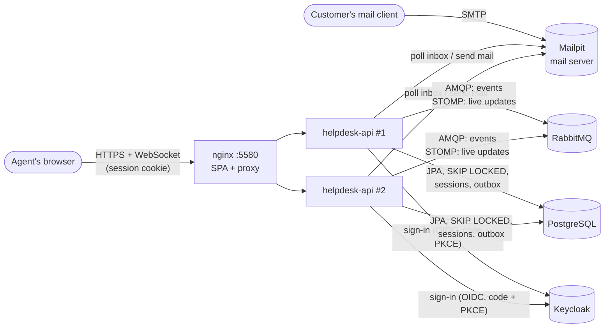
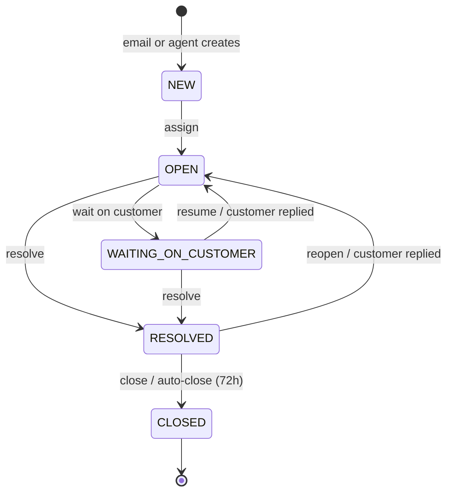

# Helpdesk with SLA tracking

A helpdesk and ticketing system in the style of Zendesk or Jira Service Management, built
around the hard part of such systems: **service-level agreements**. Customers email a
support address and get a ticket; agents work it in a live-updating web app; SLA clocks
count business hours, pause while the team waits on the customer, and a background worker
warns and escalates before and after a deadline is missed, safely across several app
instances.

**Stack:** Java 25, Spring Boot 4.2 (MVC, Security 7, Data JPA / Hibernate 7, AMQP, WebSocket,
Session JDBC), PostgreSQL 18, RabbitMQ 4.3 (with its STOMP plugin), Keycloak 26.8, Mailpit,
React 19 + TypeScript + Vite + Tailwind + TanStack Query, nginx, Docker Compose, GitHub Actions.

| What it shows | Where |
|---|---|
| Ticket lifecycle as an explicit state machine (exhaustive `switch`, compiler-checked) | [`TicketStatus`](services/helpdesk-api/src/main/java/com/helpdesk/ticket/TicketStatus.java) |
| Business-hours calendar maths (weekends, holidays, daylight saving) | [`BusinessCalendar`](services/helpdesk-api/src/main/java/com/helpdesk/sla/BusinessCalendar.java) |
| SLA clocks stored as deadlines in the database, pausable, restart-proof | [`SlaTimer`](services/helpdesk-api/src/main/java/com/helpdesk/sla/SlaTimer.java) |
| Escalation worker that is safe with N instances (`FOR UPDATE SKIP LOCKED`, idempotent) | [`SlaEscalationWorker`](services/helpdesk-api/src/main/java/com/helpdesk/sla/SlaEscalationWorker.java) |
| Transactional outbox, relayed to RabbitMQ with publisher confirms | [`events/`](services/helpdesk-api/src/main/java/com/helpdesk/events) |
| Idempotent consumers, retries, dead-letter queues | [`messaging/`](services/helpdesk-api/src/main/java/com/helpdesk/messaging), [`NotificationListener`](services/helpdesk-api/src/main/java/com/helpdesk/notification/NotificationListener.java) |
| Live updates over WebSocket/STOMP, fanned out across instances by RabbitMQ | [`WebSocketConfig`](services/helpdesk-api/src/main/java/com/helpdesk/config/WebSocketConfig.java), [`useLiveUpdates`](web/src/live/useLiveUpdates.ts) |
| Email to ticket: Message-ID dedup, reply threading, mail-loop protection | [`mail/inbound/`](services/helpdesk-api/src/main/java/com/helpdesk/mail/inbound) |
| Append-only audit history (DB trigger + withheld privileges) | [`V1__schema.sql`](services/helpdesk-api/src/main/resources/db/migration/V1__schema.sql) |
| The API as its own backend-for-frontend: OIDC sign-in, no tokens in the browser | [`SecurityConfig`](services/helpdesk-api/src/main/java/com/helpdesk/config/SecurityConfig.java) |
| Deterministic time in tests (injectable `Clock`), concurrency tests with real Postgres | [`src/test`](services/helpdesk-api/src/test/java/com/helpdesk) |

## Run it

Needs Docker Desktop (at least 4 CPUs and 6 GB of memory for Docker) and Windows PowerShell
(5.1 is fine). No local JDK or Node needed. On a fresh machine, see
[Run it on a new machine](AGENTS.md#run-it-on-a-new-machine) in AGENTS.md: prerequisites,
script permissions, troubleshooting.

```powershell
Set-ExecutionPolicy -Scope Process -ExecutionPolicy Bypass   # if Windows blocks the scripts; this window only
.\scripts\init-env.ps1                 # once: writes .env with random local secrets
docker compose up -d --build --wait    # the whole stack; the first build takes several minutes
.\scripts\demo.ps1                     # the end-to-end demo (about 4 minutes)
```

| URL | What |
|---|---|
| http://localhost:5580 | The helpdesk. Sign in as `ada` (admin), `sam` (supervisor), `ann` or `ben` (agents); the password is `DEMO_USER_PASSWORD` in `.env` |
| http://localhost:48025 | Mailpit: every email, in and out |
| http://localhost:45673 | RabbitMQ management (user `helpdesk`, password `RABBITMQ_PASSWORD` in `.env`) |
| http://localhost:8680 | Keycloak (admin console user `admin`, password `KEYCLOAK_ADMIN_PASSWORD` in `.env`) |

**The demo** ([`scripts/demo.ps1`](scripts/demo.ps1)) sends a customer email to
support@helpdesk.test and then: the email becomes ticket HD-n and the customer is
acknowledged; Ann triages it as urgent and picks it up; she replies (first response met; the
reply is emailed) and waits on the customer, which pauses the clock; the customer replies to
her email, which is threaded onto the ticket and resumes the clock; nobody resolves it, so
the worker warns and then escalates; Sam is notified in the app and by email. Sign in as
`sam` at http://localhost:5580 first to watch it happen live, or run
`.\scripts\watch-live.ps1` in a second terminal to see the raw WebSocket pushes. The demo
shortens the urgent SLA to minutes; `.\scripts\seed-demo.ps1 -RestoreSla` puts it back.

`.\scripts\smoke-test.ps1` checks the browser path without a browser: it signs in through
Keycloak's real login form, then checks the session cookie on both API instances, CSRF, the
WebSocket's origin check, a live update over the cookie-authenticated WebSocket, and sign-out.

Send your own emails with `.\scripts\send-email.ps1 -Subject "..." -Body "..."` (to
`support@helpdesk.test` or `billing@helpdesk.test`), or from any mail client pointed at
SMTP `localhost:41025`.

## Architecture



Both API instances run the same code, including all background jobs. They coordinate only
through Postgres (row locks, unique constraints) and RabbitMQ (competing consumers), so
there is no leader election and any instance can die at any moment.

How one change travels, e.g. an agent resolving a ticket:

1. `POST /api/tickets/1001/actions/RESOLVE` reaches either instance. In **one transaction** it
   locks the ticket row, checks the state machine (409 if illegal) and permissions (403),
   updates the ticket and stops its SLA clocks, appends an audit entry, and writes a
   `ticket.status-changed` event to the **outbox** table.
2. The **outbox relay** (on any instance) publishes unpublished rows to the `helpdesk.events`
   topic exchange and marks them published once RabbitMQ **confirms** them.
3. Each consumer has its own queue: **live updates** (push a "ticket 1001 changed" hint
   through the STOMP relay to every browser), **notifications** (in-app + supervisor email),
   **customer email**. A consumer that keeps failing sends the message to its dead-letter queue.
4. Browsers receive the hint over their WebSocket and refetch the ticket through the API.

## Ticket lifecycle



`NEW` means exactly "unassigned" (a CHECK constraint enforces it). A customer email about a
closed ticket opens a new, linked follow-up ticket. The transitions live in one place,
[`TicketStatus.next`](services/helpdesk-api/src/main/java/com/helpdesk/ticket/TicketStatus.java):
nested switch expressions without `default`, so adding a status or action doesn't compile
until every transition is decided.

Who may do what ([`TicketPermissions`](services/helpdesk-api/src/main/java/com/helpdesk/ticket/TicketPermissions.java)):
every staff member can see every ticket; the **assignee** replies, waits, resolves and closes;
**queue members** pick up unassigned tickets ("next ticket") and reopen; **supervisors**
can do anything, including assigning to others; **admins** also edit SLA policies and queue
membership. Status codes: 404 doesn't exist, 403 not allowed, 409 the state forbids it,
422 business rule (with `errors[]`), 400 malformed.

## SLA rules

Every ticket has two clocks: **first response** (until an agent's first public reply) and
**resolution** (until resolved). Targets come from the policy for the ticket's priority:

| Priority | First response | Resolution | Calendar | Warn at |
|---|---|---|---|---|
| Urgent | 30 min | 4 h | 24x7 | 75% |
| High | 1 h | 8 h | Office hours | 75% |
| Normal | 4 h | 24 h (3 working days) | Office hours | 75% |
| Low | 8 h | 40 h (5 working days) | Office hours | 75% |

* **Business time.** "Office hours" is Monday-Friday 09:00-17:00 Europe/London, minus England
  bank holidays. A normal ticket arriving Friday at 16:30 with a 4-hour target is due
  Monday 12:30. Opening hours stay 09:00-17:00 local across daylight-saving changes.
* **Pauses.** While a ticket waits on the customer, both clocks stop; time already used is
  kept and the deadline moves out when the clock resumes (the customer replies, or an agent
  resumes it).
* **Stops.** The first public reply meets the first-response target. Resolving meets both
  (a resolution answers the customer too). Reopening restarts the resolution clock where it
  stopped.
* **Warning** when the clock has used its warning share (75%) of the target: the assignee is
  notified (or, for unassigned tickets, the queue's members).
* **Breach** at the deadline: the breach is recorded at the deadline itself (not when the worker
  noticed), the ticket's escalation level goes up by one (it's highlighted everywhere), and the
  assignee and all supervisors are notified, supervisors also by email.
* **Priority changes** keep the time already used but apply the new targets; if the new target
  is already exceeded, the ticket is due immediately. Running clocks keep the targets they
  started with when an admin edits a policy (fairness: no deadline moves under an agent's feet).

## Design decisions

1. **Deadlines in the database, not timers.** Each clock stores `consumed_seconds`,
   `running_since`, and the precomputed `due_at` / `warn_at`. The worker only asks "which
   running clocks are past due?" (two small partial indexes). A restart, a crash, or a
   deployment loses nothing, and any instance can do the work. The business-hours maths runs
   only when a clock starts, pauses or resumes.
2. **Multi-instance safety by row locks, not leader election.** The worker locks due tickets
   with `SELECT ... FOR UPDATE SKIP LOCKED`: two instances get disjoint batches, and nobody
   waits, so nobody deadlocks. The ticket row is the lock for the whole aggregate (ticket +
   clocks); API requests take the same lock (`PESSIMISTIC_WRITE`), so a worker never races an
   agent on the same clock. The handler re-checks the freshly loaded clock (idempotent), and a
   unique index on `audit_events (ticket_id, action, metric)` makes a second "breached" record
   impossible even if the code were wrong. A test runs four workers at once over 60 due tickets.
3. **Transactional outbox, at-least-once delivery.** A change and its event commit together
   (`Propagation.MANDATORY`), so the system never announces something that didn't happen.
   The relay marks a row published only after RabbitMQ's publisher confirm; failures back
   off exponentially. Duplicates are possible by design, so every consumer records the event
   ids it has handled (`processed_messages`) in the same transaction as its own writes.
   Order isn't guaranteed either (two relays, two competing consumers), and nothing relies on
   it: live updates only say "refetch", and each notification stands alone.
4. **RabbitMQ rather than Kafka.** The work here is per-message routing to a few independent
   consumers with retries and dead-lettering, plus WebSocket fan-out. RabbitMQ does all of
   that out of the box (topic exchanges, DLX, the STOMP plugin) in one light container.
   Kafka's strengths (replayable logs, very high throughput, stream processing) aren't needed.
5. **WebSockets that scale out.** Spring's STOMP *broker relay* forwards to RabbitMQ's STOMP
   plugin, so a push from any instance reaches browsers on all instances; nginx needs no
   sticky sessions. Pushes are hints ("HD-1001 changed"), never data: the browser refetches
   through the REST API, which applies permissions. Clients may only subscribe to
   `/topic/tickets` and their own `/topic/agent.<id>`, and can't send.
6. **The API is its own backend-for-frontend.** It signs users in with Keycloak as a
   confidential client (code + PKCE) and keeps the result in an HTTP session stored in Postgres
   (Spring Session JDBC), so both instances share sessions without adding Redis. The browser
   gets only an HttpOnly, SameSite=Lax cookie; state-changing requests need a CSRF header; the
   WebSocket handshake checks the origin. Scripts use Keycloak bearer tokens instead (verified
   per request: signature, issuer, and the `helpdesk-api` audience).
7. **Email intake.** Mailpit stands in for the company mail server, read through its REST
   API ([`MailpitMailbox`](services/helpdesk-api/src/main/java/com/helpdesk/mail/inbound/MailpitMailbox.java));
   in production that one class would become an IMAP client or a provider's inbound webhook.
   Everything after "here are the raw bytes" is protocol-independent:
   * **dedup**: `INSERT ... ON CONFLICT (message_id) DO NOTHING` is the first statement, so the
     same email fetched twice (retry, or two pollers at once) is processed once;
   * **threading**: `In-Reply-To`/`References` against every Message-ID we've seen or sent for a
     ticket, then a `[HD-1001]` subject token; only the ticket's own customer can add to it
     (knowing a Message-ID mustn't let a stranger write into someone's conversation);
   * **loop protection**: `Auto-Submitted`, `Precedence: bulk/list`, our own addresses, and our
     own `X-Helpdesk-Origin` header are ignored; our auto-replies carry `Auto-Submitted`;
   * **quoted text** below our "reply above this line" marker, `On ... wrote:` or Outlook's
     separator is dropped; HTML-only mail is reduced to text. Bodies are shown as plain text.
8. **Least privilege in the database.** Flyway migrates as `helpdesk_owner`; the app connects as
   `helpdesk_app`, which can't change the schema, can't UPDATE/DELETE the audit history or the
   conversation, and can't edit calendars. A trigger also rejects changes to history.
9. **Time is injected.** Everything asks a `Clock` bean for "now". Tests replace it with
   `MutableClock` and move it by hand: "warns at exactly 22.5 minutes, breaches at 30, records
   the breach at 10:30 even though the worker only ran at 15:00".
10. **Everyone sees every ticket.** One support team; visibility rules would complicate handovers.
    Permissions are about what you may change, enforced in the service (the UI shows exactly
    the `allowedActions` the API returns, and re-checks nothing).

## API

All under `/api`, JSON, errors as RFC 9457 problem details.

| Method and path | What | Who |
|---|---|---|
| `GET /me` | Signed-in agent, roles, queues | staff |
| `GET /tickets?queueId&status&assignee=me\|unassigned\|<id>&priority&escalated&q&page&size&sort` | Search, with SLA clocks | staff |
| `POST /tickets` | Log a ticket for a customer | staff |
| `GET /tickets/{id}`, `GET /tickets/{id}/history` | Detail (messages, clocks, allowed actions), audit history | staff |
| `POST /tickets/{id}/messages` | Public reply (emailed) or internal note | assignee/supervisor for public |
| `POST /tickets/{id}/actions/{ASSIGN\|WAIT_ON_CUSTOMER\|RESUME\|RESOLVE\|REOPEN\|CLOSE}` | Move through the lifecycle (`{"assigneeId": n}` for ASSIGN) | see permissions |
| `PUT /tickets/{id}/priority` | Re-prioritise (re-targets the clocks) | assignee, supervisor, or member if unassigned |
| `POST /queues/{id}/next` | Claim the most urgent unassigned ticket (204 if none) | queue member |
| `GET /queues`, `PUT /queues/{id}/members` | Queues with counts; membership | staff; admin |
| `GET /agents` | Staff list | staff |
| `GET /sla-policies`, `PUT /sla-policies/{priority}`, `GET /calendars` | SLA targets (with optimistic `version`) | staff; admin |
| `GET /dashboard/sla` | Queue load, 7-day compliance, breaches per day, due next | staff |
| `GET /notifications`, `POST /notifications/{id}/read`, `POST /notifications/read-all` | Own notifications | staff |

WebSocket: STOMP over `ws://localhost:5580/ws`; subscribe to `/topic/tickets` and
`/topic/agent.<your id>`.

## Tests

```powershell
# API: Checkstyle, javac -Xlint:all -Werror, unit tests, and integration tests against real
# Postgres, RabbitMQ (with STOMP) and Mailpit containers. About 5 minutes on Docker Desktop.
docker run --rm -v "${PWD}\services\helpdesk-api:/workspace" -v helpdesk-sla-m2:/root/.m2 -v /var/run/docker.sock:/var/run/docker.sock -e TESTCONTAINERS_HOST_OVERRIDE=host.docker.internal -w /workspace eclipse-temurin:25-jdk sh mvnw -B verify
```

```powershell
# Web, with Node 24 on the host
cd web; npm ci; npm run lint; npm test; npm run build
# ...or without Node, in a container
docker run --rm -v "${PWD}\web:/app" -v /app/node_modules -w /app node:24-alpine sh -c "npm ci --no-audit --no-fund && npm run lint && npm test && npm run build"
```

| Area | Tests |
|---|---|
| Business calendar | weekends, holidays, before/after hours, Friday to Monday, daylight saving in both directions, lunch breaks, a property test that "add" and "measure" agree |
| SLA clock | warn/breach instants, pause/resume, warn once, breach dated at the deadline, retargeting, office hours |
| State machine | every (status, action) pair, clock behaviour per status |
| Worker | warning then breach then nothing more; paused clocks never breach; catching up after downtime; office-hours deadlines; **4 concurrent workers over 60 due tickets escalate each exactly once** |
| API | full lifecycle, 401 without session (no redirect), CSRF required, 403/404/409/422/400, "next ticket" priority order, **5 agents claiming concurrently never share a ticket**, history can't be rewritten even with direct SQL, admin-only policy edits with optimistic locking |
| Messaging | outbox marked published only after broker confirm, notification on assignment, **redelivered event notifies once**, breach notifies supervisors in-app and by email, unreadable message lands in the DLQ |
| Email | real SMTP to Mailpit becomes a ticket and is acknowledged, **same email twice (also concurrently) = one ticket**, reply threading resumes the clock and strips quoted text, subject-token threading, strangers can't join a thread, follow-up for closed tickets, auto-replies and loops ignored |
| WebSocket | a change is pushed through the real RabbitMQ STOMP relay; subscribing to another agent's topic is refused; the handshake needs a valid token |
| Bearer tokens | valid, wrong audience, tampered, no helpdesk role, no CSRF needed, admin-only endpoints |
| Web | SLA countdown formatting, safe post-login redirects, CSRF header, single redirect on bursts of 401s, ticket page shows exactly the server's actions and renders email bodies as text |

## Ports

All bound to 127.0.0.1, chosen not to clash with other local projects.

| Port | Service |
|---|---|
| 5580 | web (nginx) |
| 8580, 8581 | API instances 1 and 2 (direct, for debugging) |
| 8680 | Keycloak |
| 45432 | Postgres |
| 45672, 45673 | RabbitMQ AMQP, management UI |
| 41025, 48025 | Mailpit SMTP, web UI/API |

## Layout

```
services/helpdesk-api/   Spring Boot API (+ workers, mail intake, WebSocket endpoint)
web/                     React SPA and its nginx config
infra/                   Postgres init (logins), Keycloak realm, RabbitMQ plugins/config
scripts/                 init-env, seed-demo, demo, smoke-test, send-email, watch-live (PowerShell)
.github/                 CI (tests, lint, image build + scan) and Dependabot
```

## Not done yet

In the order they'd be built. [AGENTS.md → Status](AGENTS.md#status-whats-built-and-whats-left)
has the detail for each.

1. The CI workflow has not run yet (no remote repository).
2. Housekeeping jobs for old published outbox rows and processed-message ids. Spring Session
   already deletes expired sessions.
3. Attachments: multipart parts are skipped today.
4. Inbound mail over IMAP or a provider webhook instead of Mailpit's API.
5. Sender verification: a real system would check SPF/DKIM/DMARC results before trusting `From`.
6. Calendars and holidays are migration-managed; editing them at runtime would need running
   clocks to be re-scheduled.
7. Dashboard numbers are computed live with SQL; at scale they'd be precomputed from events.
